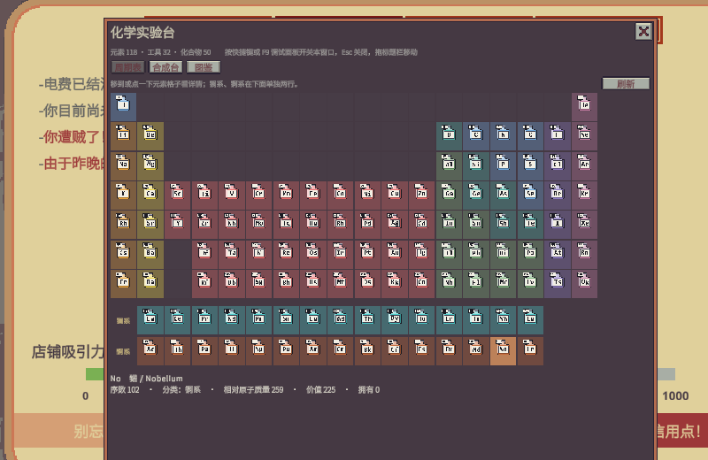
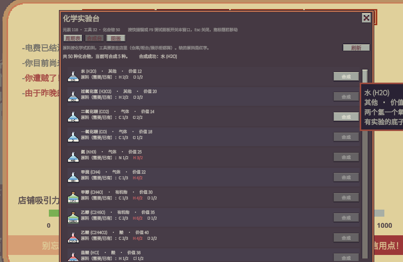
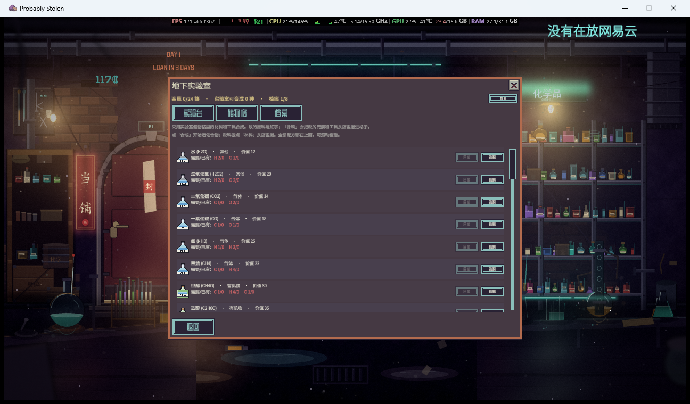

# 化学实验台（Chemistry）

给《深空当铺》加一套化学系统：**118 种元素单质 → 32 件化学工具 → 550 种按真实化学式合成的化合物**，
合成出来的东西都是新物品，能摆上柜台卖给顾客；另外还有一间可以亲自下去的 **地下实验室** 场景
（默认 644 格专用储物、实验室合成、8 章背景故事线），以及一条从当铺接单开始的 **委托线**
（找料 → 送检 → 制剂 → 回收 → 交货拿钱 → 扩产接更大的单）。地下室额外容量可在模组设置中调整。
后续迭代会接「化学公司」经营线（见 `DESIGN.md`）。

- 游戏：深空当铺 0.46D（Unity 2021.3 + Mono，自带 mod 加载器）
- 模组 id：`chemistry`　程序集：`Chemistry.dll`
- 快捷键：**F6** 打开实验台（模组设置可改键）。按 **F9 → 特殊 → 化学调试面板**，可直达地下实验室、领取测试包或检查掉落与库存。

> 已经进游戏实测通过：注册 750 件物品（元素/工具/550 种化合物/样品/反应台）、掉落接入、开局补给、周期表/合成台/图鉴三页、
> 合成扣料与产出入库、物品价值全部正常。完整日志证据和截图见 [`docs/VERIFICATION.md`](docs/VERIFICATION.md)。
>
> 第一次安装：本地 mod 默认不加载，需要进游戏 **Mods 菜单 → 选中「化学实验台」→ 启用 → 重启游戏** 一次。





## 玩法

游戏时钟由 Chemistry 推进和存档。每 20 游戏刻推进 1 游戏分钟，默认现实 1 秒走 20 刻。仪器、生产线和合成的进度按游戏刻结算，改变时钟速度会一起改变加工速度。暂停菜单会暂停游戏刻，营业阶段到达时间边界等待手动操作时，工序仍可继续。速度和自动开关店选项在 Chemistry 的「游戏时间」设置下。安装 DayHud 时，左上角表盘可显示 Chemistry 提供的时钟。

1. **捡样品**：垃圾场会掉未知样品、化合物和化学工具。金属碎片、烧蚀电路板、混合矿渣、
   密封液样和采样气瓶各有不同批次。原版废金属也可以送检。开局基础试剂和器皿仍可在设置里关闭。
   垃圾场**不再直接掉单质**——元素只能从样品里提炼，或者在委托记录里花钱采购。
2. **看周期表**：F6 → 周期表页，18 列 × 7 行 + 镧系/锕系两行；点元素看序号、分类、原子量、
   价值和仓库里有多少。
3. **合成**：F6 → 合成台页，选一种化合物，看它要哪些元素、哪些工具。
   原料和工具都齐了按「合成」，扣料、产出入仓库，产物直接是正常物品。
4. **卖钱**：化合物、多余的元素、工具都可以按正常物品摆柜/卖给顾客。元素按每克折算，瓶装物按容量计价，单件、整瓶或一格堆叠最高 350 信用点。
5. **废料回收**：用光谱仪扫描固体废料，然后在「检测与提炼」打开反应台。选择废料批次和目标金属，会显示指定的酸与库存。
   双击地下实验室里提炼反应台旁边的「制酸装置」打开机器面板，也可从反应台或实验室配方列表进入。
   烧杯和锥形瓶都能装进器皿槽；把兼容工具或空试剂瓶拖到制酸装置本体上也能直接装槽。
   用左右箭头切换配方，按原料栏显示的数量从储物格拖入游戏材料，再把对应工具和 **1 个空试剂瓶** 放进各自的槽。
   装齐后点「启动制备」，进度依次显示反应、收集和灌装，最后从成品槽拖出试剂。每批消耗所需原料和空瓶，工具保留。
   这里的配方和工序是游戏规则，不是现实制备方法。普通废金属的铁走盐酸工序，电路板的铜走硝酸工序，部分矿渣走乙酸或磷酸工序。
   完成酸浸、过滤和还原。每步显示预计产物和反应进度。把酸拖到废料上、把漏斗拖到浸出液上也能打开反应台并预先装入物料。
   浸出液和滤液随存档保存。每个批次产出 1 份目标单质，废料用量按游戏内含量计算。液体、气体及可直接分离的成分走蒸馏器交互。
6. **地下实验室**：交通界面的「地下实验室」（F9 也可直达）有原版样式的可拖放储物槽，默认可保存 **644 组物品堆叠**（模组设置可调整额外格数）、
   只用储物格材料工作的实验台（可一键补料）、以及 **8 章背景故事线**（首次到访 / 首次合成 / 酸 / 有机物 /
   危险品 / 图鉴 50·150·400 种解锁，每章一次性信用点奖励 + DayHud 通知），故事最后会指向「深空化学公司」。
7. **接委托**：老锈会来当铺谈第一笔生意——他要一份从废料里亲手提出来的铁。
   接单后 F6 的「委托」页（地下实验室面板里也有一页，F9 也有独立入口）会列出步骤：
   看过成分报告 → 制备盐酸 → 酸浸/过滤/还原出铁 → 回店交付。
   光谱仪报告里会多一行「本单要铁：这批含 72%，1 份出一份，走提炼反应台酸浸（盐酸）」，
   直接告诉你这批料够不够、走哪个工位。缺工具时每单可以领一次 **借用工位**（用完记得还）。
   结清首单后开放铜回收单、试剂补货单，以及第 12 天之后的 DSC-07 长期合同；
   同一页还能按价采购稀有元素，免得后期配方卡在「只能翻垃圾」上。

合成规则和化学式完全绑定：`H2O` 就扣 2 份氢 + 1 份氧，`Ca(OH)2` 就扣 1 钙 + 2 氧 + 2 氢。
化学式写错、元素不存在、工具没带，合成台会直接告诉缺什么。

### 硝酸生产线

在地下实验室双击制酸装置，点「硝酸生产线」。实验室配方列表以及需要硝酸的提炼工序也能直接打开。

1. **手工作坊**。从垃圾场找废弃采样气瓶和工具，在实验室用光谱仪检测气瓶。将含氮样品放入预处理工位，装上烧杯。高品位批次每份用 1 件，低品位批次每份用 2 件。随后把每步产物拖到下一工位，依次用加热磁力搅拌器转化、用漏斗过滤，再装入空试剂瓶并手动灌装。
2. **实验室批处理**。把 4 个回收机件、1 份瓶装硝酸、1 台蒸馏器放入控制台施工槽，建造实验室设备组。每个工位可独立排入 1–4 份，装料后会逐份处理和灌装，玩家负责把工艺料转入下一道工序。预处理可选择优先或限定气瓶品位。
3. **工业联机**。把 8 个机件、2 个动力匣和 1 台高压灭菌锅放入施工槽，建造工业联机设备组。把气瓶放入原料仓，把空瓶和动力匣放入公用槽，然后启动联机。工位按固定管线自动处理和入库。达到成品库存上限时暂停，取走成品后继续。转化每份消耗 1 个动力匣。控制台显示库存、进度和每实时时产量。

机件可以从垃圾场获得，也可在控制台拆解烧蚀电路板或购买。动力匣随工具掉落。设备组放在实验室内即可生效。加工队列、各槽物料和联机设置随存档保存，离开地下实验室时暂停，返回后恢复。配方使用游戏内物品和工序。

## 规模

| 类别 | 数量 | 说明 |
| --- | --- | --- |
| 元素 | 118 | 周期表全部元素，含镧系/锕系；目录参考价值 3~260，游戏售价按每克折算 |
| 化学工具 | 32 | 玻璃器皿 / 加热 / 测量 / 分离提纯 / 安全防护 |
| 化合物 | 550 | 氧化物/氢氧化物/酸/盐/有机物/气体/矿物共 550 种；前 50 种是 v10 老配方，新增 500 种按真实化学式配平 |

## 开发

数据在 `data/*.csv`，C# 数据表和物品贴图由生成脚本产出，**改数值改配方改数据，不要手改生成的 C#**：

- `fill_element_properties.py`：`data/sources/periodic_table.json` + `element_lore.csv` → `data/elements.csv` 物性列
- `gen_elements.py`：`data/elements.csv` → `src/Data/ElementTable.cs`
- `author_compounds.py`：生成/校验 `data/compounds.csv`（550 种）+ 同步 CATALOG 第 5 节
- `gen_compounds.py`：`data/tools.csv` + `compounds.csv` → `src/Data/{ToolTable,CompoundTable}.cs`
- `gen_material_sprites.mjs`：重建 118 个元素、550 个化合物的物品图与液位/气量配置
- `gen_liquid_masks.py`：改动瓶身或观察窗后，按贴图更新液面蒙版
- 美术导入脚本：美术素材 → `Textures/Paper` 场景图
- `verify.py`：数据 + 贴图 + 契约验收

这些生成脚本和美术原图只留在本地开发目录，不进仓库；仓库里放的是它们生成的 `data/`、`src/Data/` 和 `Textures/`。
固体用 `gen_material_sprites.mjs` 生成的粉末盘或晶粒盘。液体和气体有三种瓶型：小号 **100 mL**、中号 **200 mL**、大号 **400 mL**。玻璃和塑料各有三种空瓶。倒液或设备灌装保留所用瓶子的大小，倒空退回对应尺寸和材质；占格不变。
部分酸以实验室溶液形态表现。超重元素的颜色和形态用于游戏示意。
元素符号和化学式角标、液位和气量由游戏运行时绘制。大号瓶不画角标，以免盖住瓶盖，物品提示仍显示化学式。液位与刻度按对应瓶型容量显示。
液体用随瓶型加载的 `*_fill_mask.png` 和装量共同裁切：玻璃瓶按瓶身轮廓，塑料瓶和大液桶只显示观察窗。颜色按正片叠底的方式合成，保留原贴图里的明暗。
倒液后两边的液面平滑升降；拖动瓶子时液面轻微晃动，旋转后液面仍朝屏幕水平方向回稳。动画不改变实际装量。
悬停试剂瓶、空瓶或气体采样瓶会显示原版样式的装量进度条与「当前 / 最大 mL」。每个内部单位显示为 25 mL，旧库存保留原有装量；超过瓶型上限的旧气瓶不能再合入气体。破损瓶显示空进度条和 0 mL 有效容量，不可灌装。在化学调试面板选择「全容器测试包」，可领取玻璃试剂瓶、塑料试剂瓶和气体采样瓶各自的小、中、大号样品，每种尺寸都有空瓶、满瓶和破损瓶，另附半满液瓶和气瓶。
把装有液体的瓶子拖到同种试剂瓶或空试剂瓶上可以倒液，瓶子倒空后可以回填。气体用瓶内颜色深浅和刻度表示气量。
容器材质是游戏规则：标记为腐蚀玻璃的试剂装进塑料瓶可保留试剂；装进玻璃瓶会损失本次倒入或制备的试剂，并留下不可灌装的破损玻璃试剂瓶。制酸面板会提前提示，正常倒空则返还原材质的空瓶。

大容器是独立物品：气体钢瓶 **5,000 mL**、大液桶 **4,000 mL**，各自只储存一种物质，可与相容的小容器转装。废液桶可合收 **2,000 mL** 液体废料；废物桶可收 **40 件** 废金属、废电路板或矿渣。废料投入后不可取回，装量显示在容器详情。可从化学调试面板领取「大容器测试包」。实验室储物格打开时，测试包送到实验室，否则送往当铺库存。
大液桶占 **3×3 格**；废液桶和废物桶各占 **4×4 格**；气体钢瓶占 **2×4 格**，大号气体采样瓶占 **1×4 格**（横放 **4×1**）。同一容器装满或倒空不改变占格；旧库存空间不足时保留原占格。
`gen_textures.py` 和 `import_element_art.py` 是旧版贴图脚本。修改工具贴图后可运行新生成器恢复当前版的元素和化合物图。

编译（在仓库根目录）：

```
dotnet build ProbablyStolenMods.sln -c Release
```

编完自动部署到游戏的 `Mods\Chemistry\`，进游戏（模组菜单里确认启用）即可。
只想验证编译不碰游戏目录：`-p:DeployToMods=false`。

数据契约（id 命名、CSV 列、锁定的工具/化合物清单、配色、贴图规格）见 [`data/CATALOG.md`](data/CATALOG.md)，
系统设计和后续「化学公司」规划见 [`DESIGN.md`](DESIGN.md)。

## 文件结构

```
Chemistry/
├─ Chemistry.csproj / manifest.xml
├─ data/            CSV 数据源 + CATALOG.md（数据契约）+ LAB_CONTRACT.md（地下实验室契约）+ ORDER_CONTRACT.md（委托契约）
├─ Textures/Items/  32×32 物品贴图（元素 = 材质拼图导入 / 工具、化合物 = 程序化）
├─ Textures/Paper/  地下实验室场景背景 1920×1080 + 交通卡片 592×336
├─ docs/            验收记录 + 游戏内截图 + 玩法路线图
└─ src/
   ├─ ChemistryMod.cs        入口：事件、设置、快捷键、F9 入口
   ├─ Core/                  数据定义、化学式解析、id 约定、文案、快捷键宿主
   ├─ Data/                  生成的数据表（元素 / 工具 / 化合物）+ 元素渠道盘点
   ├─ Game/                  物品注册、仓库扫描、合成服务、掉落接入、调试补给
   ├─ Lab/                   地下实验室：地点/背景舞台、可配置储物、实验室合成
   ├─ Order/                 委托线：模板、状态机、借用工位、NPC、原料采购
   ├─ Story/                 8 章背景故事线 + 解锁奖励 + 离店事件
   └─ UI/                    实验台窗口 + 地下实验室面板 + 委托记录
```

## 日志排查

- 游戏根目录放个空的 `dev.txt`，F8 看日志；`Player.log` 里搜 `[chemistry]` 能看到模组自己的日志。
- 在化学调试面板选择「掉落表检查」可查看接入状态。「清空模组数据」会清除当前存档的化学模组数据，包括开局补给标记。
- 没装 DayHud 也能用（通知是可选的反射调用）。
