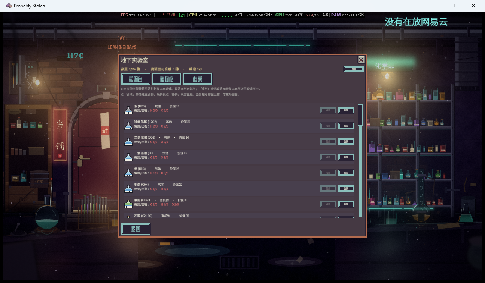
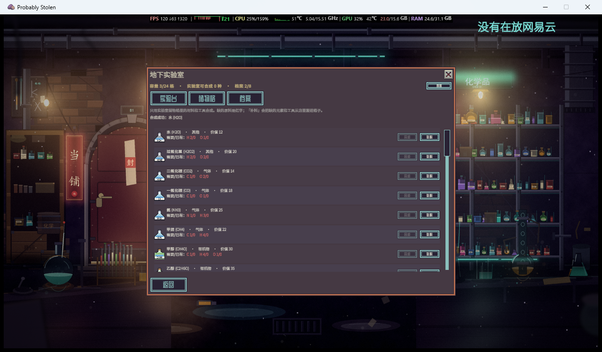
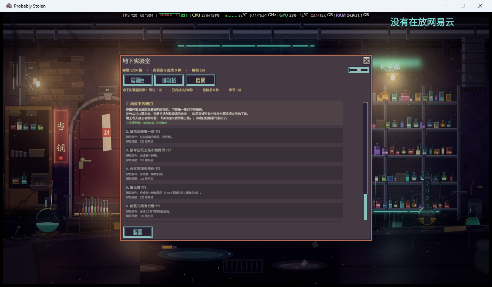

# 运行时验收记录（2026-11-18）

游戏：深空当铺 **0.46D**（VERSION 100-REV13，Unity 2021.3 + Mono）
环境：Windows 11，Steam 版，mod 以本地 mod 方式加载
模组：`chemistry` v0.1，程序集 `Chemistry.dll`，部署目录 `Mods\Chemistry\`

## 结论

**元素 → 工具 → 化学式合成** 三个阶段在真实游戏里跑通：
118 种元素、32 件工具、50 种化合物全部注册成功；开局补给、掉落表接入、
周期表 / 合成台 / 图鉴三个界面、合成扣料与产出入库、物品价值（unitValue）全部实测通过。

## 实测步骤与日志证据

### 1) 启用模组

新装的本地 mod 默认未启用（`modOrder` 里没有、`modTrust` 里也没有记录，游戏按 Unknown 拒绝加载）。
在游戏 **Mods 菜单**里选中「化学实验台」→「启用」→ 批准一次，然后重启游戏（游戏提示「模组更改将在游戏重启后生效」）。

重启后 Player.log：

```
[ModLoader] Loading: Chemistry.dll
[化学实验台]: 化学实验台装好了，游戏版本 0.46D
[化学实验台]: 数据规模：元素 118，工具 32，化合物 50
[ModLoader]   Initialized: 化学实验台 v0.1
[ModLoader] 化学实验台: 0 texture(s), 200 item sprite(s), 0 paper sprite(s) loaded
[ModLoader] audit: chemistry v0.1 source=Local workshop=0 owner=0 running=True trust=Match caps=none
```

### 2) 读档后的注册 / 掉落 / 开局补给

```
[化学实验台]: 物品目录初始化：注册 200 件物品（元素 118，工具 32，化合物 50）
[化学实验台]: 掉落表接入完成：元素 / 化合物 / 化学工具已进入垃圾场掉落
[化学实验台]: 开局补给已放进仓库：26 件（常用元素 + 基础化学工具）
[化学实验台]: 仓库化学物品盘点：16 种、26 单位；
    el_h×4 el_o×3 el_c×3 el_n×2 el_na×2 el_cl×2 el_ca×1 el_fe×1 el_cu×1 el_s×1
    tool_beaker×1 tool_conical_flask×1 tool_test_tube×1 tool_bunsen_burner×1 tool_balance×1 tool_thermometer×1；
    价格抽查 el_h=3 el_c=5 el_o=4 el_fe=12 tool_beaker=60
```

- 价格抽查证明 `unitValue` 写对了：游戏 `GameItem.GetValue` 用 `unitValue` 计价，
  抽查结果和 `data/elements.csv` / `data/tools.csv` 里的 value 完全一致（H=3、C=5、O=4、Fe=12、烧杯=60）。
- 仓库满时会逐件尝试 仓库/后柜/前柜/展示柜/夜间背包，仍放不下就报
  `补给放不进店里：<id> ×n` 并保留「未发放」状态，清理空间后重新读档会补发——
  实测满仓库（138 件）时没有物品凭空消失。

### 3) 周期表界面（F6）


- 18 列 × 7 行 + 镧系/锕系单独两行，位置由 `ElementDef.Group/Period` 决定。
- 悬停/点击显示：序数、符号、中英名、分类、相对原子质量、价值、仓库拥有数量
  （实测 Ge：序数 32 · 类金属 · 72.63 · 价值 65 · 拥有 0）。
- 每格显示模组贴图（200 张小试剂瓶 / 工具 / 化合物贴图都在游戏里正常加载）。

> 注：本节截图摄于第一版「程序化元素试剂瓶」贴图；之后 118 个元素图标已按用户要求换成
> **单质材质拼图**（切图导入，仍为 32×32 透明背景、
> 占 2×2 格），元素符号改画在图标底部的木质标签牌上。导入规格经过两轮调整：
> 第一版保留半透明抗锯齿边，实机（游戏对 Items 贴图用 **Point 采样**）看是一圈明显毛边；
> 第二版改成覆盖率二值化 + 1px 开闭收边；第三版再加 **32 色量化**去 JPEG 抖动噪点、
> **外轮廓统一 1px 深色描边**，32px 下是干净的像素剪影。alpha 只有 0/255（外加占格标记 64），
> 和程序化贴图规格一致。新版素材验收图见
> [`../tools/element_contact_sheet.png`](../tools/element_contact_sheet.png)，
> 贴图规格/静态验收已通过（`verify.py` TEX-1~TEX-6 全 PASS）。

### 4) 合成台界面 + 实际合成


- 「共 50 种化合物，当前可合成 7 种」，每行显示化学式、分类、价值和
  「原料（需要/已有）」，缺的用红字；工具在店里（仓库/柜台/展示柜）即可。
- 点击水的「合成」后：

```
[化学实验台]: 合成成功：水 (H2O)（消耗 2 H + 1 O）
```

- 界面刷新后水这一行变成 `H 2/2  O 1/2`（H 从 4 扣到 2、O 从 3 扣到 2），
  当前可合成数量从 7 变成 5 —— **扣料和产出成对，产物进了仓库**。
- 合成顺序是「先造产物 → 放进店里 → 确认进包 → 再扣元素」，仓库/柜台都满时会
  直接提示「产物放不进去，材料没扣」，不会出现扣了料没东西的情况。

### 5) 图鉴界面


- 分类筛选 + 50 种化合物列表（名称、化学式、分类、价值），点条目显示描述、配方和工具需求。

### 6) 编译 / 部署 / 数据验收

```
dotnet build ProbablyStolenMods.sln -c Release -p:DeployToMods=false   → 0 warning / 0 error
python Chemistry/tools/verify.py                                       → PASS 68 / FAIL 0 / exit 0
```

部署产物：`Mods\Chemistry\{Chemistry.dll, manifest.xml, Textures\Items\*.png ×200}`。

## 已知限制 / 后续

- 新装模组必须在游戏 Mods 菜单启用并批准一次，之后才会自动加载（游戏本身的安全策略）。
- 存档里如果之后禁用本模组，已获得的化学物品会因为找不到物品定义而变成异常物品——
  和所有加物品的模组一样，卸载前先把化学物品处理掉。
- 104~118 号元素的官方中文名在 CJK 扩展区，个别字体可能缺字形（物品名里同时带元素符号，
  不会认不出是哪个元素）。
- 阶段四「化学公司」还没做，设计见 [`../DESIGN.md`](../DESIGN.md) 第 7 节。

## 复跑方式

1. `dotnet build Chemistry\Chemistry.csproj -c Release`（部署到游戏 Mods\Chemistry）
2. 确认游戏 Mods 菜单里 chemistry 已启用
3. `pwsh -NoProfile -File Chemistry\tools\smoke_test.ps1` 自动启动游戏并抓启动日志
4. `python Chemistry\tools\verify.py` 跑数据/贴图/编译/契约验收

---

# 地下实验室（2026-11-18 实机验证）

场景：离店 afterhour 地点 `chemistry_lab`，通过 F9 调试入口「化学：去地下实验室」直达验证
（正常玩家可以在打烊离店的交通界面里看到「地下实验室」卡片）。

## 1) 注册与事件

Player.log：

```
[化学实验台]: 地下实验室地点已注册（chemistry_lab）
[化学实验台]: 地下实验室故事线已就绪：8 章档案 + 3 个实验室离店事件
[ModLoader] Paper sprite loaded: lab_background (化学实验台)
[ModLoader] Paper sprite loaded: lab_card (化学实验台)
```

- F9「打烊后事件」面板里能看到「地下实验室 / chemistry_lab」一栏，以及
  `chem_lab_hood_knocking`（通风橱异响）、`chem_lab_notes_moved`（旧笔记被动过，9% 概率/天）、
  `chem_lab_company_visit`（公司的人来过，6%/2 天）三个离店事件，tooltip 里中英描述正常。

## 2) 场景与面板

> 注：本节的实机截图摄于第一版「程序化生成的背景」；之后背景和地点徽章已按用户要求换成
> **新的美术素材**（徽章为透明背景 PNG），构图与尺寸一致、已重新部署，
> 静态验收通过。



- 1920×1080 场景背景铺满（当铺暗门 + 「封」条、试剂货架、烧瓶/冷凝管、地面反光）；
- 面板居中显示（原版 `panelPosition` 是给窄面板设计的，会把 1000×740 面板顶出屏幕右侧；
  本轮加了 `src/UI/LabPanelAnchor.cs` 在窗口出现后连续几帧校正到屏幕中央，复测居中正常）；
- 顶部摘要「容量 x/48 格 · 实验室可合成 N 种 · 档案 X/8」，三个标签页可正常切换。

## 3) 48 格容量格 + 从店里补料


- 储物格页：8×6 共 48 格，已用/总格数实时显示；「从店里存入」列表列出当铺里的化学物品和数量；
- 实验台点「补料」：H 2 份、O 1 份、烧杯、本生灯从当铺搬进实验室，摘要变成「容量 4/48 格、
  可合成 1 种」，水行变成 H 2/2、O 1/1；同时店里氢 4→2、氧 3→2（扣店库存成对）。

## 4) 实验室合成 + 故事解锁




```
[化学实验台]: 实验室档案解锁 ch1《地板下的暗门》，奖励 80 信用点
[化学实验台]: 实验室档案解锁 ch2《旧笔记的第一页》，奖励 120 信用点
[化学实验台]: 合成成功：水 (H2O)（实验室储物格）
```

- 合成后摘要变「容量 3/48 格 · 可合成 0 种 · 档案 2/8」，水行 H 2/0、O 1/0（扣料成对）；
- 储物格里剩 3 格：烧杯、本生灯、水×1（产物优先进实验室格子）；
- 档案页显示进度「到访 1 次 · 已合成 0/50 种 · 危险品 0 种 · 章节 2/8」，ch1/ch2 正文与
  「一次性奖励（已领取）」，ch3 之后显示 ??? + 解锁条件；
- 面板「返回」正常回到当铺柜台，HUD/背包正常。

## 5) 结论

前往 → 背景/面板 → 48 格容量 → 存取补料 → 实验室合成 → 故事解锁奖励 → 返回，**整条链路实机通过**。
`verify.py` 对契约/故事/美术/构建的静态验收同样全 PASS（见 `tools/VERIFY_REPORT.md`）。
运行时唯一修过的问题是面板位置（见第 2 节）。


---

# 元素信息与物品类型修复（2026-11-18 下午）

用户实机截图发现两个问题：① 元素物品提示里出现 `[Translation Error 'type_chemical' in Mechanic]`；
② 元素描述只有一句「第 8 号元素，非金属，相对原子质量 15.999。」，太单薄。

## 1) 物品类型翻译报错

原因：`ItemRegistration.ApplyCommon` 给物品设了自定义类型 `CHEMICAL` / `CHEM_ELEMENT`（拼成 `CHEM_`+kind），
游戏的 `TypeHelper.GetTypeDisplayName` 会拿 `type_` + 小写类型名去 `Mechanic` 本地化表查，查不到就渲染成
`[Translation Error 'type_xxx' in Mechanic]`（来自 `CommonTooltipHelper.CreateItemTypeTooltip`，它遍历
`GameItem.GetGameItemType()` 逐个加 ` [类型名]`）。

修复：改成原版就有的类型名——
元素/化合物用 `CHEMICAL_SUPPLIES`（原版化学品类型），工具用 `TOOL`。
这两个 key 在游戏 `resources.assets` 里存在 `type_chemical_supplies` / `type_tool` 本地化条目
（扫描确认），所以提示里会正常显示本地化后的类型名，不再出现 Translation Error。

## 2) 元素描述详细化（参照 ptable.com 的「性质/系列」）

数据管线：

```
data/sources/periodic_table.json         公开元素数据集（Bowserinator/Periodic-Table-JSON，只取 1~118 号）
        │
data/element_lore.csv                    118 行自写简介（symbol, summary_zh, summary_en）
        │
        ▼  python tools/fill_element_properties.py
data/elements.csv                        21 列：核心 9 列 + 物性 12 列（K→℃，缺失留空）
        │
        ▼  python tools/gen_elements.py
src/Data/ElementTable.cs                 ElementDef 新字段：Phase/MeltC/BoilC/Density/
                                         DensityUnit/Electronegativity/ElectronConfig/Block/
                                         DiscoveredBy/NamedBy/SummaryZh/SummaryEn
```

物品提示框最终只显示三段（用户明确要求去掉数值行，物性数据仍保留在 CSV 和 ElementDef 里备用；简介为扩写版 77~97 字）：

```
第 26 号元素 · 铁（Fe）
过渡金属 · 第 4 周期 第 8 族 · d 区 · 常温：固体
人类用得最多的金属，地核的主要成分，血红蛋白靠它运送氧气。钢、铸铁和锈迹支撑了整个工业文明，火星的红土也是氧化铁，当铺里铁价最实在。铁锈和泥土里的破伤风菌是老搭档，踩到旧钉子要当心。
```

被去掉的渲染行：相对原子质量·电负性 / 熔点·沸点·密度 / 电子排布 / 发现者（数据仍在）。
古老元素（`Ancient Egypt` / `5000 BC` 这类）在数据里归一成空值；镧系/锕系显示「镧系 / 锕系」而不是「第 0 族」。

## 3) 结论

类型报错已消除（不再有自定义 `CHEM_*` 类型）；元素提示改成三段式（身份 / 分类位置 / 扩写简介），
原来那几行数值不再渲染（用户要求），但物性数据仍保留在 elements.csv 与 ElementDef 里。
`verify.py` 已同步扩展元素数据/描述检查（见 `tools/VERIFY_REPORT.md`）。


---

# 遗留店铺 UI 修复（2026-11-18 晚）

用户截图：从当铺直接下到地下实验室后，店里的「展示柜（商品摆放）」「地面库存」面板、
「离开店铺」按钮还画在实验室场景上。

原因：`LabEntranceButton`（店里「前往地下室」按钮）和 F9「去地下实验室」都直接调
`MapUIManager.Travel()`，绕过了原版「离开店铺」流程。（2026-11-23 注：该按钮已下架，
店内入口改为桌腿通风柜 `LabEntranceVent`，IsAtStore/CanEnter 判断搬进了它里面。）
原版流程会调用
`EmporiumEntry.OnLeaveStore()`：快照当前打开的店铺面板 → 关闭展示柜/地面/前后柜台/垃圾桶/
自贩机等 PixelWindow → 隐藏店内可交互物与 HUD → 触发 `OnLeavingStoreEarly/Late`。
少了这一步，店铺 UI 不会被关闭，切场景后就留在画面上。

修复：`LabLocation.TravelHere()` 在 `manager.Travel(target)` 之前，若玩家还在店里
（`!IsOutside && !IsInTransit`）先调 `EmporiumEntry.Instance.OnLeaveStore()`；
返回当铺时游戏自己的 `MapUIManager.CloseUI(true)` 会 `RestoreStoreUIAfterReturn()` 把面板原样恢复。

验证：编译 0 warning / 0 error；待用户实机确认「店内开着展示柜/地面面板 → 前往地下室 → 场景干净；
返回当铺后面板恢复」。


---

# 拖拽式成分检测 / 提炼（2026-11-18 深夜）

用户要求：检测和提炼不要面板按钮，要像游戏里的机器一样「把检测器拖到未知样品上」触发，
并弹出 UI 显示这件样品带的成分。

实现：

- **判定/回调挂在物品自己身上**：游戏 `GameItem` 继承 `GameItemFunc`，每件物品有自己的
  `canItemTargetItemFunc / mayItemTargetItemFunc / onItemTargetItemFunc`，所以给「光谱仪」
  （`tool_spectrometer`）和「蒸馏器」（`tool_distiller`）在工具工厂里挂委托即可，不动全局钩子。
- **检测**：光谱仪拖到任意样品上 → 音效 + 日志浮层 + DayHud「光谱仪正在扫描…」→ 0.9 秒后弹出
  「成分检测报告」：样品名/图标、每个成分的元素图标 + 中文名 + 百分比、杂质百分比；未知样品同时被
  改写成同批次 `_detected` 物品（名字加「（已检测）」），实验室储物格数量跟着同步。
- **提炼**：蒸馏器拖到**已检测**样品上 → 弹出「提炼」窗口，按成分列出「耗样品 N 份 · 现有 M 份」，
  点某个成分提炼：优先扣实验室储物格，不够再从当铺仓库扣（产物先放好再扣样品，失败回滚），
  产出对应元素。
- **旧面板按钮全部取消**：实验室「检测与提炼」页现在只显示储物格里的样品进度与拖拽提示。
- **测试入口**：F9 → 特殊 → 模组面板 →「化学：样品测试包（样品+光谱仪+蒸馏器）」，
  一次发 4 件未知样品 + 光谱仪 + 蒸馏器。

编译 0 warning / 0 error；静态验收见 `tools/VERIFY_REPORT.md`。拖拽的实机手感待用户确认。


---

# 实验室储物格容量与网格对齐修复（2026-11-19 凌晨）

用户截图：实验室里的大网格看起来还有很多空格，但把物品拖进去没反应。

原因（两个问题叠在一起）：
1. 场景里的原版网格按 26×12 格显示（最多能塞 78 件 2×2 物品），但逻辑容量只有 24 格（按物品种类算，
   同种叠放）；用户已经塞了 30+ 种，`CanReceive` 判定超容量后**静默拒绝**，所以看起来「有空位却放不进」。
2. 容量拒绝/存档写入失败都没有提示，玩家不知道被 24 格上限卡住；超出的物品种类也没有保存（存档写入
   同样按 24 格校验失败），返回当铺时这些物品会消失。

修复：
- **容量 24 → 48 格**（32 件化学工具 + 样品/材料能放下）；`LabStorage.Capacity = 48`。
- **场景网格与容量完全对齐**：储物格网格改成 8 列 × 6 行物品位（16×12 个格子），物理上最多就是 48 件，
  窗口标题显示「实验室储物格 · 48 格」。
- 面板「储物格」页同步改成 8 列，格子缩小以适配 48 格（8×6）。
- **拒绝有提示**：容量满时 DayHud 提示「实验室储物格满了（x/48 格）：同种物品会叠放，先把用不到的拿回店里」；
  存档写入失败（超出上限）时警告并提示「多出来的物品没有保存」。
- 文档/契约同步：`LAB_CONTRACT.md`、DESIGN、README 的 24 格改 48 格。

---

## v11 扩充（2026-11-19）：化合物 50 → 550

目标：给化学模组补 500 种化学成品，合成仍然严格按真实化学式扣料。

### 数据

- 新增 `tools/author_compounds.py`：生成/校验 `data/compounds.csv`，并整段重写 `data/CATALOG.md` 第 5 节锁定表。
- 前 50 条是 v10 老配方（key / 化学式 / 文案原样保留），后面 500 条按家族生成：
  氧化物 75、氢氧化物 26、酸 50、盐 200、有机物 120、气体 14、其它（矿物/水合物/炸药）15。
- 校验规则（脚本不通过就不写文件）：
  - 化学式能被 `FormulaParser` 同款规则解析，元素符号必须是 118 号元素表里真实存在的；
  - 盐类按阴阳离子电荷配平（例：`Ca3(PO4)2`、`Al2(SO4)3`）；
  - 有机物按不饱和度校验：`DBE = C - (H+卤素)/2 + N/2 + 1 >= 0` 且 `H+卤素-N` 为偶数；
  - key 全局唯一、中文名/英文名不重复、字段里没有英文逗号/引号/竖线/换行；
  - 化学式允许同分异构体重复（乙醇/二甲醚同为 `C2H6O`、葡萄糖/果糖同为 `C6H12O6`），生成器与验收脚本都按「同式多种」放行。
- `gen_compounds.py` 重新生成 `src/Data/CompoundTable.cs`（550 条），并逐条比对 CATALOG 第 5 节与 CSV。
- `gen_textures.py` 重新生成 `Textures/Items/cmp_*.png`（550 张 32×32），再跑 `import_element_art.py` 恢复 118 个元素图标。
- 分页：550 条一次性铺进 ScrollRect 会卡，F6 的合成台/图鉴和地下实验室的实验台都改成分页（每页 24 条，
  底部「上一页 / 第 x/y 页 / 下一页」），逻辑在 `src/UI/ChemPager.cs`。
- 故事线进度阈值同步：图鉴 50 / 150 / 400 种（原来是 10/25/50 全部）。

### 脚本自检输出（可复现）

```
python tools/author_compounds.py     -> 完成：data/compounds.csv 与 CATALOG 第 5 节已更新（550 条）
                                       分类分布：acid=55 base=29 gas=19 organic=136 other=17 oxide=79 salt=215
python tools/gen_compounds.py        -> 自检通过：工具 32 / 化合物 550，key 唯一，key 与化学式同 CATALOG 完全一致
python tools/gen_textures.py         -> 元素 118 / 工具 32 / 化合物 550 / 合计 700；全部 32x32 RGBA
python tools/import_element_art.py   -> Textures\Items 回写 118 个 32x32 RGBA 元素图标
python tools/verify.py --skip-build  -> PASS 134 / FAIL 3
```

剩余 3 个 FAIL（`LAB-15` / `LAB-16` / `SAMPLE-6`）属于同时进行的「废金属提炼反应台 / 储物格 48→144」改动，
不是本次化合物扩充引入的，等那个功能收尾后再跑一次 `verify.py` 即可。

### 游戏内实测（2026-11-19）

- 启动日志：
  `[化学实验台]: 数据规模：元素 118，工具 32，化合物 550`
  `[化学实验台]: 物品目录初始化：注册 750 件物品（元素 118，工具 32，化合物 550，含未知及已检测样品）`
  贴图加载：`707 item sprite(s)`（700 数据物品 + 6 样本/检测图标 + 1 提炼反应台）。
- F6 → 周期表：标题行正常显示「元素 118 · 工具 32 · 化合物 550」。
- F6 → 合成台：底部分页「第 1/23 页 · 共 550 种」，点「下一页」翻到第 2 页（葡萄糖/蔗糖/阿司匹林…）；
  点「合成」合成水成功，日志 `合成成功：水 (H2O)（消耗 2 H + 1 O）`，原料 H 4→2、O 3→2，
  证明扩充后的配方仍然严格按 `FormulaParser` 解析的化学式扣料。
- F6 → 图鉴：分页「第 2/23 页」，详情区显示配方「H X 2 O X 1」和工具需求。
- 地下实验室 → 实验台：分页「第 1/23 页 · 共 550 种」，翻页后第 2 页正常；
  行内「需要/已有」按化学式逐元素显示，储物格联动合成逻辑未变。

截图：`docs/screenshots/synthesis-550.png`、`compendium-550.png`、`lab-bench-550.png`、`synthesis-craft.png`。

---

# 委托线落地（2026-11-26）

按 `docs/GAMEPLAY_ROADMAP.md` 实施 M1–M4。契约见 `data/ORDER_CONTRACT.md`。

## 编译

```
dotnet build ProbablyStolenMods.sln -c Release -p:DeployToMods=false
-> 已成功生成。0 个警告，0 个错误
```

## 静态验收（`Chemistry/bin/order-check/harness`，本地工程，不进仓库）

```
dotnet run -c Release
-> PASS: 5 order templates, 118 element channels, accept/settle/rollback/borrow/purchase/expiry all behave.
```

覆盖的断言：

| 断言 | 说明 |
| --- | --- |
| 模板完整性 | 5 张委托 id 唯一、中英标题/简述齐全、报酬 > 0、有交付要求和 `deliver` 步骤、交付物能反查到名字 |
| 前置关系 | `RequiresOrder` 指向真实存在的模板；`RequiresChapter` / `RequiresDay` 生效 |
| 元素渠道 | 118 种元素每种至少一条渠道；每种都有采购渠道；**所有 550 条配方的上游元素都能拿到**（撤掉单质直掉后不会出现死配方） |
| 接单 | 前置未完成时接不了；进行中不能再接；编号从 1 递增 |
| 教学步骤 | 没做完全部教学步骤时 `CanSettle` 为假；步骤允许乱序完成 |
| 存档往返 | `EnsureLoaded` 之后进行中的委托、编号、已完成步骤都还在 |
| 结算 | 扣一份铁、发一次钱；`Active` 清空；写入结算记录 |
| 重复交付 | 第二次 `Settle` 返回 false 且不再发钱 |
| 交付失败回滚 | `TryConsume` 失败时不发钱、订单保持可重试 |
| 借用工位 | 空仓库时 `Audit` 有缺口；领一次后 `CanBorrow` 变假、第二次 `Borrow` 失败 |
| 采购 | 结清首单后解锁；钱够时按价扣款并发货；钱不够时不发货 |
| 期限 | `ResetForDebug` 清空进行中/历史/编号/信用点 |

## 源码级检查

- `LootIntegration` 里 `RegisterLootTable` / `AddLootGroupEntry` 只剩样品表和化合物表，
  没有单质表；旧的 `chemElementTable` 只在 `RemoveLegacyElementTable()` 里被清理，不再注册。
- 元素物品提示新增「来源」一行，内容来自 `ElementSources.Describe`。
- F9 新增三个入口：「化学：委托记录」「化学：元素渠道盘点」「化学：重置委托」。

## 待实机确认

以下需要进游戏点一遍（本地没有游戏进程，只做到静态验收）：

1. 新档关闭开局补给 → 接老锈试单 → 领借用工位 → 扫批次 01 或普通废金属 → 制盐酸 →
   酸浸/过滤/还原出铁 → 回店交付 → 信用点到账、订单进「已结算」。
2. 交付按钮重复点击、仓库满、余额不足、错误物品四种情况都不吞料、不双倍发钱。
3. 加工中读档、交付前后读档，委托进度按该档恢复。
4. 委托页在 F6 实验台 / 地下实验室面板 / F9 独立窗口三处都能打开并刷新。
5. 接单/收货 NPC 每天最多来一次，错过之后仍能从委托页接单。

---

# 委托线复验：两处进度卡点 + 三处规则缺口（2026-11-26 晚）

上一轮验收指出 5 个问题，逐条修掉并补了自检。

## P1-1 接单前的检测不计入首单

**原因**：`OnSampleAnalyzed` 只在有进行中的委托时才记步骤，玩家先扫废料再点接单，
这一步就被跳过了。

**修法**：加全局履历 `order_seen` / `order_made` / `order_recovered` / `order_produced`，
四个进度事件先写履历再推进当前委托；`Accept` 时按履历补记步骤（`SeedFromHistory`）。
所以「先扫了再点接单」不会被判成没做过，`produce` 也改成按累计产量判定。

## P1-2 工业线出料不推进合同

**原因**：硝酸联机线和工业车间出料后只通知故事线，`OrderService` 收不到；
而且合同要 24 单位，单批产出永远到不了，一次性事件根本判不出来。

**修法**：`OnCompoundProduced(def, units)` 带实际入库单位数；
`NitricProduction` 灌装成功按 `MachineBatch` 实际提交的 `Product.Units` 调用（当前每批 1 单位），
`IndustrialFactory.Recover` 提交成功按 1 单位调用；容器容量只表示上限，不作为生产量。
`produce` 步骤改成「累计产量 ≥ 每批交付量」。

## P1-3 首晚发现流程未接通

**修法**：

- `LootIntegration.Hook()` 订阅 `ModHook.OnLootRolled`：垃圾场首翻不是含铁样品时临时换成批次 01，
  只允许一件掉落待确认；延迟检查只有在含铁样品确实进入玩家库存后才写 `loot_first_sample`。
  背包满或掉落未拾取时释放待确认状态，之后翻找仍可重试。
- `OrderService.OnSampleAnalyzed` 先记录样品成分；首单 `RequiresAnalysis` 检查必须含 `Fe` 的履历，
  不含铁样品的报告不解锁老锈。成功查看含铁样品报告时也能确认保底样品已实际取得。
- 接单时如果手上完全没有含目标元素的废料，再补一批 01 号样品（`EnsureStarterSample`），
  不占用借用工位的机会。

## P2-1 仓满时会用掉整次借用机会

**修法**：`OrderSupply.Borrow` 只有整批都放进仓库才 `MarkBorrowed`；
仓库满时领到一部分，清出空间还能再领剩下的（没领到的部分下次 `Audit` 仍会列出来，不会重复发放）。

## P2-2 M3 / M4 的交付规则与验收表不一致

**修法**：

- `OrderRequirement.Bottles` + `BottleSize`：补货单要求 3 个满装小瓶（每瓶 4 单位）。`CanSettle` 校验指定尺寸，
  中大瓶、半瓶、空瓶、破损瓶和别的液体都不算；`TryConsumeBottled` 只扣匹配的满小瓶，完整移除三瓶，
  不从半瓶补差，也不留下空瓶。
- 发钱失败后的 `Refund` 会按原 `BottleSize` 和 `Bottles` 重建满瓶；普通堆叠物则按 `Count` 恢复原数量。
- `OrderTemplate.Lots`：DSC-07 两张合同各分 2 批交付，每次只扣一批并记 `DeliveredLots`，
  交满批数才付一次钱。

## 顺带修掉的两个 bug

- **可重复委托的前置永远不满足**：`completed` 原来只在一次性委托结算时写入，
  导致「长期合同要求先做完补货单」永远解锁不了。现在改成「至少结清过一次」就写入，
  能不能再接由 `Repeatable` 单独控制。
- **`IndustrialFactory` 用错查表方式**：`Route.Solid` 是物品 id，原来拿它去 `FindCompound`（按 key 查）。
  新增 `ChemistryCatalog.FindCompoundByItemId`。

## 自检（`Chemistry/bin/order-check/harness`，本地工程，不进仓库）

```
dotnet run -c Release
-> PASS: 5 order templates, 118 element channels, pre-accept iron scan, actual-unit production,
   guaranteed sample confirmation, exact small-bottle delivery, lot settlement, partial borrow and purchase all behave.
```

新增断言：接单前扫过的含铁报告能抵掉 `report`，不含铁报告不能解锁首单；
接单时空仓库会发保底样品；累计产量按实际提交单位；单个大瓶和半瓶组合都不能替代三只满小瓶；
三只满小瓶交付会整瓶扣除；模拟发钱失败后仍恢复三只满小瓶；仓库只放得下 2 件时借用机会不被消耗，
补齐后才消耗；合同第一批不结账、第二批付一次钱；重置会清掉全局履历。

## 编译

```
dotnet build ProbablyStolenMods.sln -c Release -p:DeployToMods=false
-> 已成功生成。0 个警告，0 个错误
```

`tools/verify.py --skip-build`：PASS 125 / FAIL 8，失败项与改动前完全一致
（LAB-3/15/16 容量 144、ART-1/5 素材规格、TYP-4 元素描述、SAMPLE-6 反应台入口、API-1 反射成员），
都不是本轮引入的。

## 仍需实机确认

1. 新档第一次翻垃圾是否稳定拿到一件可送检样品（保底只生效一次）。
2. 没扫过任何东西时委托页不出现老锈，扫过之后当天或次日出现。
3. 硝酸联机线自动跑满 24 单位后，合同页的「生产」步骤自动勾上。
4. 补货单：3 个满瓶能交，改成 2 满瓶 + 1 半瓶后按钮灰掉并给出原因。
5. 合同第一批交完不结账、第二批交完付一次 900。

---

# 委托复验：产量单位、首翻保底、小瓶交付（2026-11-26）

本轮复核发现三处规则仍与路线图不一致，并补上回归测试。

## P1 制酸与工业线按容器容量记产量

`TryCommitBottled` 每次只把 `Product.Units`（当前默认 1）写进输出槽；之前按瓶型容量调用 `OnCompoundProduced`，选择大瓶会虚增产量、合同可提前勾完。现改为严格按实际提交单位计数：酸站和硝酸线每次灌装成功记 1 单位，工业车间出料按实际 `Product.Units` 记账。瓶容量只作上限，不再当产量。

## P1 首翻保底可能被丢失

`OnLootRolled` 在实例化和放入玩家库存之前触发，不能当作玩家已拿到物品。之前即时写入 `loot_first_sample`，若背包满或物品被丢弃，保底机会就永久消耗。现改为：垃圾场非含铁样品临时替换为含铁的批次 01，设置内存待确认状态并延迟检查；只有含铁样品实际进入玩家可用库存才写入存档，失败则释放状态，后续翻找可重试。一次多物品翻找最多替换一件，避免连抽多个批次 01。

首单门槛也改为要求全局履历里出现 `Fe`：只有检测含铁样品的报告才解锁；非铁报告不会解锁老锈。打开含铁样品报告能直接确认样品已取得。

## P2 “三小瓶”仍可用大瓶代替

之前只按满瓶数量统计，未按指定尺寸筛选；扣除时还会从其他瓶或半瓶补差。现新增 `OrderRequirement.BottleSize`：盐酸补货要求 3 个满小瓶（每瓶 4 单位），校验必须同时满足瓶数、尺寸和总量；结算完整扣除三只满小瓶，不接受一只大瓶、半瓶组合或中瓶替代，也不会留下空瓶。付款失败的回滚会按原瓶型和装量重建三只小瓶；普通物品回滚也按原需求数量恢复。

## 回归与构建

```
dotnet build ProbablyStolenMods.sln -c Release -p:DeployToMods=false
-> 已成功生成。0 个警告，0 个错误

dotnet run -c Release  (Chemistry/bin/order-check/harness)
-> PASS: 5 order templates, 118 element channels, pre-accept iron scan, actual-unit production,
   guaranteed sample confirmation, exact small-bottle delivery, lot settlement, partial borrow and purchase all behave.
```

测试覆盖：含铁报告门槛、接单前报告计入、生产累计按实际单位、大瓶/半瓶拒收、三只满小瓶准确扣除、模拟付款失败后三瓶原样回滚、首翻保底确认、长期合同分批付款及部分借用重试。

## 仍需实机确认

1. 首次垃圾场翻找遇背包满时，批次 01 未入库且下一次翻找仍能获得保底。
2. 首次翻找已产出一组多物品时，最多只有其中一件被替换为批次 01。
3. 盐酸补货显示满小瓶计数；三只小瓶可交、一只大瓶或半瓶组合不可交，付款失败时库存图标和瓶型正确恢复。
4. 硝酸联机线生产一件仅增加其真实 `unitCount` 的累计产量，不按大瓶容量跳跃。
